# Autonomous Drone Roadmap

This document describes the roadmap of the Autonomous Drone project, from the first research notes to a drone that performs a real task, such as watering or fertilizing plants.

The roadmap makes three things clear at any point in the project: the current position, the next step, and the criteria for finishing each stage. Every stage follows the same structure: goal, steps, diagram, deliverables, and a completion rule.

> **Reading note:** The diagrams are written in Mermaid. They render automatically on GitHub, GitLab, VS Code (with a Mermaid preview extension) and Obsidian.

---

## Table of Contents

1. [The Big Picture](#1-the-big-picture)
2. [Documentation Structure](#documentation-structure)
3. [Stage 1: Research and Data Collection](#stage-1-research-and-data-collection)
4. [Stage 2: Define the Purpose, Design the Neural Network, Documentation and ADRs](#stage-2-define-the-purpose-design-the-neural-network-documentation-and-adrs)
5. [Stage 3: Test and Optimize](#stage-3-test-and-optimize)
6. [Stage 4: Train the Neural Network and Create the Autonomous Drone](#stage-4-train-the-neural-network-and-create-the-autonomous-drone)
7. [Stage 5: Real Drone, Real Components, Real Sensor Data](#stage-5-real-drone-real-components-real-sensor-data)
8. [Stage 6: Give the Drone a Purpose](#stage-6-give-the-drone-a-purpose)
9. [Safety Rules](#safety-rules)
10. [Known Risks](#known-risks)
11. [Progress Tracker](#progress-tracker)

---

## 1. The Big Picture

The project has six stages. Work moves forward one stage at a time, and going back to an earlier stage is allowed whenever the results are not good enough. Going back is part of the process, not a failure.

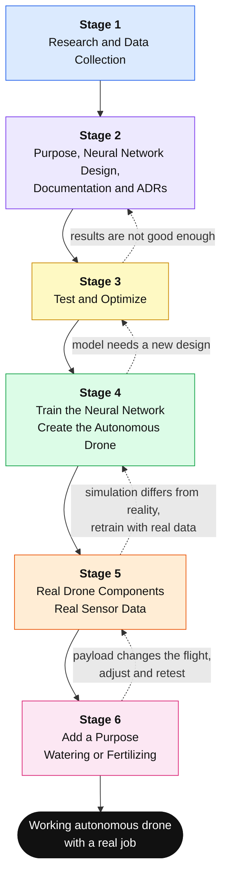

### Stage Summary

| Stage | Activity | Output | Move on when |
|-------|----------|--------|--------------|
| 1 | Collect data and do research | Research notes, a list of datasets, parts, tools and simulators | Enough is known to make real decisions |
| 2 | Define the purpose, design the neural network, write docs and ADRs | A clear purpose, architecture, neural network design and ADRs | A new reader can read the docs and understand the system |
| 3 | Test and optimize | A tested pipeline and a design that meets the targets | The prototype passes the tests and numbers |
| 4 | Train the neural network and build the autonomous drone | A trained model that flies the drone in simulation | The drone completes missions in simulation reliably |
| 5 | Build the real drone and run it with real sensor data | A real drone that flies with the model and real sensors | It completes missions safely in the real world |
| 6 | Add a feature with a purpose | A watering or fertilizing drone | It completes a real task on real plants |

---

## Documentation Structure

All project documentation lives in `docs/` and is split into two tracks: **hardware** and **software**. Each track moves through numbered phases, from framing to production (hardware) or delivery (software). Cross-cutting folders hold the topics that apply to every phase: safety, regulation, testing, verification and traceability.

> **Naming note:** The numbered phases in the documentation folders (`0-framing`, `1-requirements`, and so on) are different from the six roadmap stages in this file. The mapping table below shows which stage fills which folders.

### Folder Tree

```text
Droni/
└── docs/
    ├── hardware/
    │   ├── 0-framing/
    │   │   ├── roadmap.md
    │   │   └── vision-and-scope.md
    │   ├── 1-requirements/
    │   │   ├── functional-requirements.md
    │   │   ├── mission-requirements.md
    │   │   └── nfr.md
    │   ├── 2-architecture/
    │   │   ├── adr/
    │   │   │   ├── 0001-frame-topology.md
    │   │   │   └── 0001-off-the-shelf-hardware.md
    │   │   ├── interface-control-documents.md
    │   │   └── system-block-diagram.md
    │   ├── 3-high-level-design/
    │   │   ├── mechanical-layout.md
    │   │   └── power-budget.md
    │   ├── 4-detailed-design/
    │   │   ├── electrical/
    │   │   │   ├── pcb-layout-notes.md
    │   │   │   └── schematics.md
    │   │   ├── hardware-software-interface.md
    │   │   └── mechanical/
    │   │       ├── cad-notes.md
    │   │       ├── material-selection.md
    │   │       └── structural-analysis.md
    │   ├── 4-integration-design/
    │   │   ├── configuration.md
    │   │   ├── hardware-software-interface.md
    │   │   ├── mounting-plan.md
    │   │   └── wiring-diagram.md
    │   ├── 5-integration-and-verification/
    │   │   ├── bench-test-plan.md
    │   │   ├── bring-up-procedures.md
    │   │   ├── flight-test-plan.md
    │   │   └── test-reports/
    │   │       └── README.md
    │   ├── 6-assembly/
    │   │   ├── assembly-instructions.md
    │   │   ├── bill-of-materials.md
    │   │   ├── component_bill.xlsx
    │   │   └── maintenance-and-logistics.md
    │   ├── 6-production/
    │   │   ├── assembly-instructions.md
    │   │   ├── bill-of-materials.md
    │   │   ├── dfm-notes.md
    │   │   └── maintenance-and-logistics.md
    │   ├── architecture/
    │   ├── components/
    │   │   ├── batteries.md
    │   │   ├── flight-controllers.md
    │   │   ├── frame-and-propellers.md
    │   │   ├── motors-and-escs.md
    │   │   └── sensors-and-payload.md
    │   ├── cross-cutting/
    │   │   ├── safety-and-compliance/
    │   │   │   ├── failure-modes-and-effects.md
    │   │   │   ├── regulatory-requirements.md
    │   │   │   └── safety-case.md
    │   │   ├── traceability/
    │   │   │   └── requirements-traceability-matrix.md
    │   │   └── verification/
    │   │       └── test-and-verification-plan.md
    │   ├── design/
    │   ├── how-to-work/
    │   ├── methodology.md
    │   ├── notes/
    │   ├── README.md
    │   ├── road-map/
    │   └── sources/
    └── software/
        ├── 0-framing/
        │   ├── roadmap.md
        │   └── vision-and-scope.md
        ├── 1-problem-space/
        │   ├── domain-model.md
        │   ├── edge-case-research.md
        │   ├── nfr.md
        │   ├── requirements-spec.md
        │   └── use-cases.md
        ├── 2-architecture/
        │   ├── adr/
        │   │   └── 0001-example-decision.md
        │   ├── c4-container.md
        │   └── c4-context.md
        ├── 3-high-level-design/
        │   ├── aggregate-model.md
        │   └── component-diagram.md
        ├── 4-detailed-design/
        │   ├── api-contract.md
        │   ├── erd.md
        │   ├── lifecycles.md
        │   └── sequence-flows.md
        ├── 5-delivery/
        │   ├── build-plan.md
        │   └── ci-cd-and-ops.md
        ├── architecture/
        ├── cross-cutting/
        │   ├── security/
        │   │   └── threat-model.md
        │   ├── testing/
        │   │   └── test-strategy.md
        │   └── traceability/
        │       └── rtm.md
        ├── domain/
        ├── high-level-design/
        ├── how-to-work/
        ├── methodology.md
        ├── notes/
        ├── README.md
        ├── requierments/
        │   ├── fr/
        │   └── nfr/
        ├── road-map/
        └── sources/
            └── ENGINEERING-ROADMAP.pdf
```

Code and data folders (for example `sim/`, `ml/`, `firmware/`, `data/` and `tests/`) live next to `docs/` and are created when the stage that needs them starts.

### What Each Folder Is For

| Folder | Purpose |
|--------|---------|
| `0-framing` | Vision, scope and the roadmap |
| `1-requirements` (hardware), `1-problem-space` (software) | What the system must do: functional, mission and non-functional requirements, domain model, use cases and edge cases |
| `2-architecture` | System block diagram, interfaces, C4 diagrams and the ADRs |
| `3-high-level-design` | Mechanical layout, power budget, components and aggregates |
| `4-detailed-design` | Schematics, CAD and structural analysis (hardware). API contract, ERD, lifecycles and sequence flows (software) |
| `4-integration-design` | Wiring, mounting, configuration and the hardware-software interface |
| `5-integration-and-verification` | Bench tests, bring-up, flight tests and test reports |
| `5-delivery` | Build plan, CI/CD and operations (software) |
| `6-assembly`, `6-production` | Bill of materials, assembly instructions, maintenance, and DFM notes for production |
| `components/` | Research notes for each component category |
| `cross-cutting/` | Safety, regulation, verification, security, testing and traceability |
| `sources/`, `notes/` | Reference material and raw research notes |
| `methodology.md`, `how-to-work/`, `README.md` | How the documentation is written and used |

### Documentation Flow

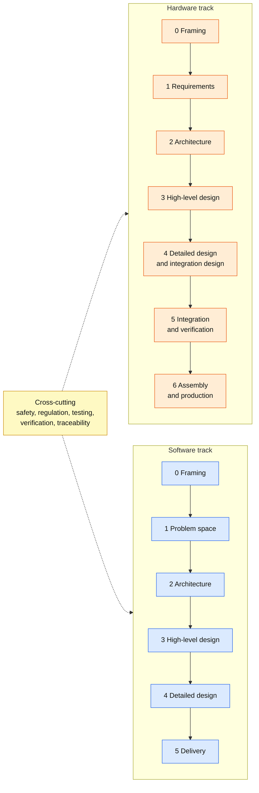

### Mapping: Roadmap Stages to Documentation Folders

All paths are relative to `docs/hardware/` or `docs/software/`.

| Roadmap stage | Hardware track | Software track |
|---------------|----------------|----------------|
| Stage 1: Research | `components/`, `sources/`, `notes/`, `cross-cutting/safety-and-compliance/regulatory-requirements.md` | `sources/`, `notes/`, `1-problem-space/edge-case-research.md` |
| Stage 2: Purpose, design, docs, ADRs | `0-framing` to `3-high-level-design` | `0-framing` to `4-detailed-design` |
| Stage 3: Test and optimize | `cross-cutting/verification/`, `5-integration-and-verification/bench-test-plan.md` | `cross-cutting/testing/`, `5-delivery/ci-cd-and-ops.md` |
| Stage 4: Train and create the autonomous drone | `2-architecture/interface-control-documents.md` (interfaces kept in sync with the simulation) | `5-delivery/build-plan.md`, `4-detailed-design/sequence-flows.md`, `4-detailed-design/lifecycles.md` |
| Stage 5: Real drone and real sensor data | `4-detailed-design`, `4-integration-design`, `5-integration-and-verification`, `6-assembly` | `5-delivery`, `cross-cutting/security/threat-model.md` |
| Stage 6: Purpose | `components/sensors-and-payload.md`, `3-high-level-design`, `4-integration-design`, `cross-cutting/safety-and-compliance/` | `4-detailed-design/lifecycles.md`, `4-detailed-design/sequence-flows.md` |
| Throughout | `cross-cutting/traceability/`, `6-production` (only when going beyond a one-off drone) | `cross-cutting/traceability/rtm.md` |

---

## Stage 1: Research and Data Collection

### Goal
Understand what already exists before anything is built. The aim is to avoid reinventing problems that are already solved and to avoid making big decisions without information.

### Research Topics

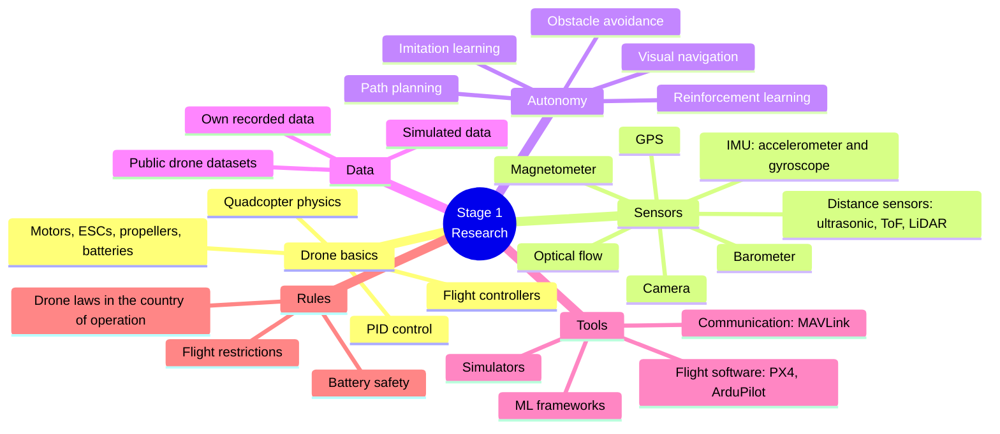

### Steps

**Step 1.1: Learn the fundamentals.**
Study how a quadcopter flies: how the four motors create lift, how changing motor speeds creates roll, pitch and yaw, and how the flight controller keeps the drone stable using a control loop (PID). This shows which part of the system the neural network should control and which part should be left alone.

**Step 1.2: Research the existing flight software.**
Compare PX4 and ArduPilot. Both are open-source flight stacks, both support MAVLink, and both can be tested in simulation before any real hardware is used. List the pros and cons of each.

**Step 1.3: Research the sensors.**
For each sensor, record what it measures, how accurate it is, how fast it updates, how much it weighs, how much power it uses, and how much it costs. Collect everything in one comparison table.

**Step 1.4: Find datasets.**
Collect public datasets related to drones and navigation. Examples to investigate:

- EuRoC MAV (flight data with camera and IMU)
- UZH-FPV Drone Racing dataset
- Blackbird dataset
- TartanAir (simulated navigation data)
- VisDrone and UAV123 (aerial images and object tracking)

For each dataset, note the sensors used, the size, the license, and whether it fits the purpose.

**Step 1.5: Find simulators.**
Compare simulators: Gazebo with PX4 SITL, Isaac Sim, AirSim-based projects, and lighter Python options such as gym-pybullet-drones. Check how realistic the physics is, how easy the setup is, and whether camera and depth sensors are supported.

**Step 1.6: Read papers and projects.**
Read papers and open-source projects on drone navigation with neural networks. Reading the abstract alone is not enough. Write a short summary of each one covering the problem it solves, the input the network uses, the output it gives, and its weak points.

**Step 1.7: Check the rules.**
Check the drone laws of the country of operation: where flying is allowed, the maximum height, whether registration is required, and the rules for flying with a payload or spraying anything. This is done early so it does not cause surprises in Stage 5 and Stage 6.

### How Research Becomes Decisions

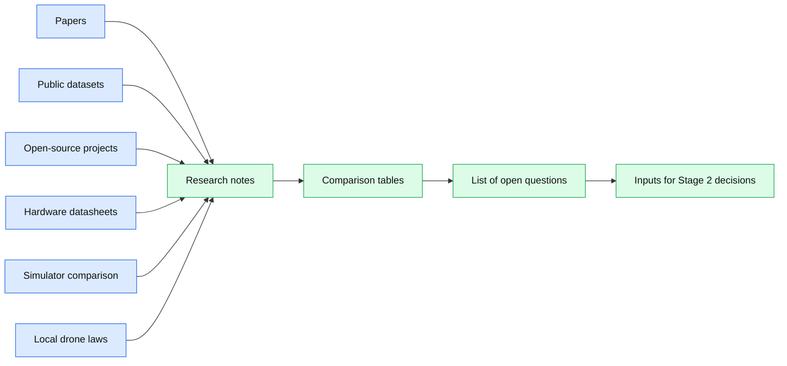

### Deliverables
- [ ] Research notes with summaries of the papers and projects: `docs/hardware/notes/` and `docs/software/notes/`
- [ ] Sensor comparison table: `docs/hardware/components/sensors-and-payload.md`
- [ ] Notes for the other component categories: `docs/hardware/components/` (`batteries.md`, `frame-and-propellers.md`, `motors-and-escs.md`)
- [ ] Flight stack and flight controller comparison (PX4 vs ArduPilot): `docs/hardware/components/flight-controllers.md`
- [ ] Dataset list (name, link, size, license, sensors, usefulness): `docs/software/notes/datasets.md` (new file)
- [ ] Simulator comparison table: `docs/software/notes/simulator-comparison.md` (new file)
- [ ] Edge cases found during research: `docs/software/1-problem-space/edge-case-research.md`
- [ ] Short note about the drone laws of the country of operation: `docs/hardware/cross-cutting/safety-and-compliance/regulatory-requirements.md`
- [ ] Reference papers and PDFs: `docs/software/sources/` and `docs/hardware/sources/`
- [ ] List of open questions: `docs/hardware/notes/open-questions.md` (new file)

### Completion Criteria
Stage 1 is complete when it is possible to explain, in simple words, how the drone will fly, which sensors it might use, where the training data will come from, and which tools will be used to simulate it.

---

## Stage 2: Define the Purpose, Design the Neural Network, Documentation and ADRs

### Goal
This stage moves from collecting to deciding. It defines what the drone is supposed to do, what the neural network is responsible for, and records everything so every decision is clear and traceable.

### Step 2.1: Define the Purpose

A base purpose comes first. The final purpose (watering or fertilizing) arrives in Stage 6, but the drone needs a base ability before that. The base purpose is:

> **The drone takes off, flies to a target location by itself, avoids obstacles on the way, and lands safely.**

Everything in Stages 2 to 5 is built to make this work. Stage 6 builds on top of it.

The following items are **out of scope for now**, to keep the project focused:

- Flying in strong wind or rain
- Flying in a group with other drones
- Night flying
- Anything that needs a perfect map

### Step 2.2: Decide What the Neural Network Does

This is the most important design decision of the project.

| Option | Description | Advantages | Disadvantages |
|--------|-------------|------------|---------------|
| A. End-to-end | The network reads sensors and directly controls the motors | Elegant, very autonomous | Hard to train, hard to debug, risky to fly |
| B. High-level only | The network reads sensors and gives movement commands. The flight controller keeps the drone stable | Safer, easier to debug, uses proven stabilization | The network does not control everything |

**The current plan is Option B.** The flight controller (PX4 or ArduPilot) keeps the drone stable, and the neural network decides *where to go*. This choice is confirmed in an ADR.

### Step 2.3: Design the System Architecture

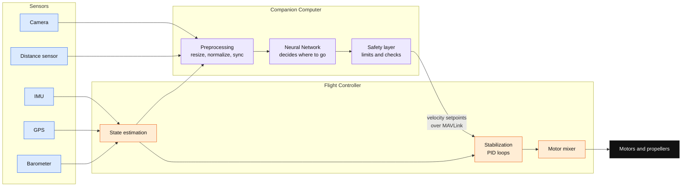

### Step 2.4: Design the Neural Network

The design is written down before any training code is written.

**Inputs (what the network sees):**
- A camera image, reduced to a small size so it runs fast (for example 128 by 128 pixels)
- A depth or distance reading, if a distance sensor is used
- The drone's current state: velocity, orientation and height
- The direction and distance to the target

**Outputs (what the network decides):**
- Forward velocity
- Sideways velocity
- Vertical velocity
- Yaw rate (how fast the drone turns)

**Learning method (current plan):**
1. Start with **imitation learning**: an "expert" is built in simulation (a classic planner that already knows the map), and the network learns to copy it.
2. If needed, improve it later with **reinforcement learning**.

**Framework:** PyTorch, exporting to ONNX so the model can run on the companion computer later.

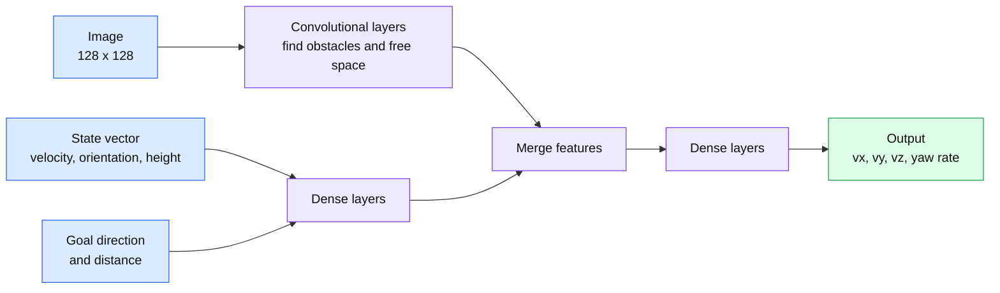

### Step 2.5: Choose the Hardware Direction (On Paper Only)

Nothing is purchased at this point. Only the direction is decided so the software design matches.

| Part | Options under consideration | Decision recorded in |
|------|-----------------------------|----------------------|
| Flight controller | Pixhawk-compatible board running PX4 or ArduPilot | Hardware ADR 0005, Software ADR 0001 |
| Companion computer | Raspberry Pi 5 or NVIDIA Jetson | Hardware ADR 0004 |
| Camera | Wide-angle RGB camera, possibly a depth camera | Hardware ADR 0003 |
| Distance sensor | Time-of-flight or LiDAR rangefinder | Hardware ADR 0003 |
| Communication | MAVLink between companion computer and flight controller | Software ADR 0005 |

### Step 2.6: Write the Documentation

The documentation follows the structure described in [Documentation Structure](#documentation-structure) and lives in the same repository as the code. Stage 2 fills the early phases of both tracks:

| Phase | Hardware track (`docs/hardware/`) | Software track (`docs/software/`) |
|-------|-----------------------------------|-----------------------------------|
| `0-framing` | `vision-and-scope.md`, `roadmap.md` | `vision-and-scope.md`, `roadmap.md` |
| `1-requirements` / `1-problem-space` | `functional-requirements.md`, `mission-requirements.md`, `nfr.md` | `domain-model.md`, `requirements-spec.md`, `use-cases.md`, `nfr.md`, `edge-case-research.md` |
| `2-architecture` | `system-block-diagram.md`, `interface-control-documents.md`, `adr/` | `c4-context.md`, `c4-container.md`, `adr/` |
| `3-high-level-design` | `mechanical-layout.md`, `power-budget.md` | `component-diagram.md`, `aggregate-model.md` |
| `4-detailed-design` | Not yet. It waits for Stage 5, when the parts are chosen | `api-contract.md`, `erd.md`, `lifecycles.md`, `sequence-flows.md` |

The `traceability` files in `cross-cutting/` are started here as well, so every requirement can be followed to a design decision and later to a test.

### Step 2.7: Write the ADRs

An ADR (Architecture Decision Record) is a short document that explains **one decision**: what was decided, why, and what it costs. One is written every time an important choice is made, so the reason behind it can be recovered later.

**Location and naming:** hardware ADRs live in `docs/hardware/2-architecture/adr/` and software ADRs in `docs/software/2-architecture/adr/`. Files are named `NNNN-short-title.md`, and numbers are unique within each track.

**ADR template:**

```markdown
# ADR-0000: Title of the decision

- **Status:** Proposed | Accepted | Replaced by ADR-XXX
- **Date:** YYYY-MM-DD

## Context
What problem is being solved? What is known? What are the limits (budget, time, weight, power)?

## Options considered
1. Option A: pros and cons
2. Option B: pros and cons

## Decision
What was chosen and the main reason why.

## Consequences
What gets easier? What gets harder? What needs to be watched?
```

**ADRs planned for this stage:**

Hardware track, in `docs/hardware/2-architecture/adr/`:

| File | Decision |
|------|----------|
| `0001-off-the-shelf-hardware.md` | Off-the-shelf parts vs custom hardware |
| `0002-frame-topology.md` | Frame topology (the existing `0001-frame-topology.md` is renumbered so the two files no longer share 0001) |
| `0003-sensor-set.md` | Sensor set for the first real drone |
| `0004-companion-computer.md` | Raspberry Pi 5 or NVIDIA Jetson |
| `0005-flight-controller.md` | Flight controller hardware |

Software track, in `docs/software/2-architecture/adr/`:

| File | Decision |
|------|----------|
| `0001-flight-stack.md` | PX4 or ArduPilot (replaces the placeholder `0001-example-decision.md`) |
| `0002-simulator.md` | Simulator used for development and training |
| `0003-ml-framework-and-export-format.md` | ML framework and model export format |
| `0004-neural-network-role.md` | Neural network role: end-to-end or high-level only |
| `0005-mavlink-communication.md` | Communication between companion computer and flight controller |
| `0006-safety-and-failsafe-strategy.md` | Failsafes, geofence and manual override (referenced from the hardware safety case) |

### Deliverables
- [ ] Purpose statement with what is in scope and out of scope: `docs/hardware/0-framing/vision-and-scope.md` and `docs/software/0-framing/vision-and-scope.md`
- [ ] Requirements: `docs/hardware/1-requirements/` and `docs/software/1-problem-space/`
- [ ] System architecture diagrams: `docs/hardware/2-architecture/system-block-diagram.md`, `docs/software/2-architecture/c4-context.md` and `c4-container.md`
- [ ] Interfaces between sensors, companion computer and flight controller: `docs/hardware/2-architecture/interface-control-documents.md`
- [ ] Neural network design (inputs, outputs, learning method): `docs/software/3-high-level-design/component-diagram.md` and `docs/software/4-detailed-design/`
- [ ] Hardware ADRs 0001 to 0005 and software ADRs 0001 to 0006 written
- [ ] Measurable targets for Stage 3: `docs/software/1-problem-space/nfr.md` and `docs/hardware/1-requirements/nfr.md`
- [ ] Traceability started: `docs/hardware/cross-cutting/traceability/requirements-traceability-matrix.md` and `docs/software/cross-cutting/traceability/rtm.md`

### Completion Criteria
Stage 2 is complete when someone who has never seen the project can read the docs and understand what the drone does, how it is built, and why each choice was made.

---

## Stage 3: Test and Optimize

### Goal
Before spending a lot of time and compute on full training, prove that the **pipeline works** and that the **design is good enough**. Finding mistakes now is much cheaper than finding them after days of training.

### Step 3.1: Set Measurable Targets

Testing is based on numbers, not impressions, and the numbers are written first. These are starting targets and can be changed through an ADR when there is a good reason. They are recorded as non-functional requirements in `docs/software/1-problem-space/nfr.md`, and hardware limits (weight, power, flight time) in `docs/hardware/1-requirements/nfr.md`:

| Metric | Target |
|--------|--------|
| Mission success rate in simulation | At least 90% |
| Collisions | Less than 1 per 100 meters flown |
| Model speed on the target computer | At least 20 decisions per second (50 ms or less per decision) |
| Distance from the planned path | Under 1 meter on average |
| Model size | Small enough to run on the companion computer without overheating |

### Step 3.2: Test the Pieces Separately

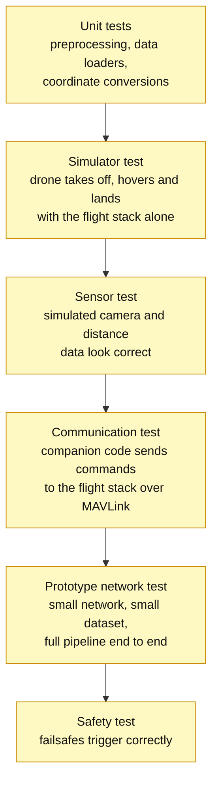

**What each test proves:**
- **Unit tests:** the code does what is intended (for example, images are resized correctly and the direction to the goal is calculated in the right coordinate frame).
- **Simulator test:** the simulator and the flight stack work together before the neural network is involved.
- **Sensor test:** the simulated sensors give data in the same format as the real sensors will later.
- **Communication test:** a command can be sent and the drone moves the way it is expected to.
- **Prototype network test:** a very small network is trained on a small dataset to prove that data goes in, a decision comes out, and the drone moves. The result does not need to be good. It needs to **work**.
- **Safety test:** when the connection is cut, the battery level drops, or the drone leaves the allowed area, the drone does what the safety and failsafe ADR (software ADR 0006) specifies.

### Step 3.3: Optimize

Once the pipeline works, it is improved. Only things that have been measured are optimized.

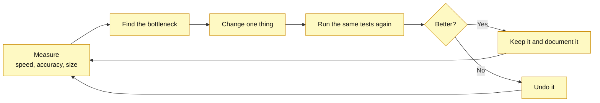

Options to try, one at a time:
- Make the input image smaller
- Use fewer or lighter layers in the network
- Quantization (store the weights with fewer bits so the model is smaller and faster)
- Pruning (remove weights that do not matter)
- Export to ONNX and test faster runtimes
- Improve data loading so training does not wait for data

**Rule:** change **one thing at a time** and run the same test again. Changing five things at once makes it impossible to know which one helped.

### Step 3.4: Write a Test Report

Each round of testing gets a short report covering what was tested, the numbers obtained, what failed, and what will change. Simulation and software reports go in `docs/software/cross-cutting/testing/test-reports/` (new folder), and hardware and flight reports go in `docs/hardware/5-integration-and-verification/test-reports/`. If a design decision changes because of the results, a new ADR is written and the old one is marked as replaced.

### Deliverables
- [ ] Test strategy and automated tests for the code: `docs/software/cross-cutting/testing/test-strategy.md`
- [ ] Automated test runs in CI: `docs/software/5-delivery/ci-cd-and-ops.md`
- [ ] A working end-to-end prototype in simulation (even with a weak network)
- [ ] A table of measured numbers compared with the targets
- [ ] Bench test plan for the later hardware tests: `docs/hardware/5-integration-and-verification/bench-test-plan.md`
- [ ] Overall verification plan: `docs/hardware/cross-cutting/verification/test-and-verification-plan.md`
- [ ] Test reports: see Step 3.4 for the locations
- [ ] Updated ADRs if any decision changed

### Completion Criteria
Stage 3 is complete when the pipeline runs end to end without manual fixes, the speed and size targets are met, and the design is good enough to justify full training.

---

## Stage 4: Train the Neural Network and Create the Autonomous Drone

### Goal
Train the real model and turn the prototype into a drone that flies by itself in simulation.

### Step 4.1: Build the Training Data

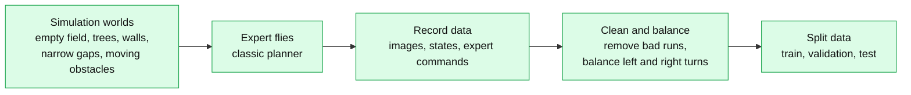

Key points:
- Many different worlds are built so the network does not memorize one place.
- Lighting, textures, obstacle positions and sensor noise are randomized. This is called **domain randomization**, and it helps later when moving to the real world.
- A **test set** is kept aside that the network never sees during training. It is only used at the end.

### Step 4.2: Train

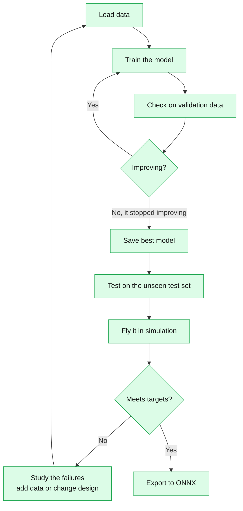

Training guidelines:
- Every training run is logged (settings, results, model version) so runs can be compared.
- The gap between training results and validation results is watched. If training is great and validation is bad, the model is memorizing, not learning.
- Good numbers on a dataset are **not enough**. The model must also fly well in the simulator, because small mistakes add up over time while flying.
- If imitation learning gets stuck on certain failures, those situations are added to the data (the idea behind DAgger-style data collection), or reinforcement learning is used for fine-tuning.

### Step 4.3: Create the Autonomous Drone (in Simulation)

All parts are connected into the final software pipeline:

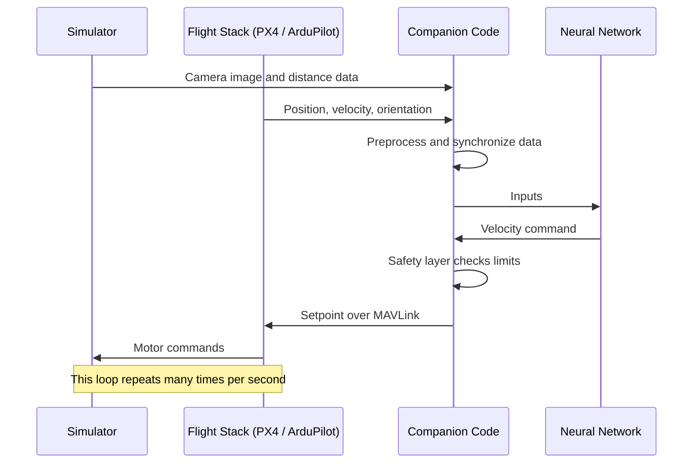

Full missions are then tested:
1. Take off
2. Fly to a target through obstacles
3. Land at the target

Each mission runs hundreds of times in different randomized worlds, recording the success rate, the collisions and the time taken.

### Deliverables
- [ ] A dataset with a documented structure and split: `docs/software/4-detailed-design/erd.md`
- [ ] A trained and versioned model with its training logs
- [ ] An ONNX export of the final model
- [ ] Build and training plan: `docs/software/5-delivery/build-plan.md`
- [ ] Simulation loop and mission flow documented: `docs/software/4-detailed-design/sequence-flows.md` and `lifecycles.md`
- [ ] A full mission demo video in simulation
- [ ] A results report comparing the numbers against the targets: `docs/software/cross-cutting/testing/test-reports/`
- [ ] An ADR for any important design change

### Completion Criteria
Stage 4 is complete when the drone completes missions in simulation reliably across many random worlds and meets the targets defined in Stage 3.

---

## Stage 5: Real Drone, Real Components, Real Sensor Data

### Goal
Move from the simulator to the real world. This is the stage with the highest risk, so progress is slow and careful, and a way to take back manual control is always available.

### Step 5.1: Choose and Buy the Components

Research notes for each component category live in `docs/hardware/components/` (`batteries.md`, `flight-controllers.md`, `frame-and-propellers.md`, `motors-and-escs.md`, `sensors-and-payload.md`). The final selection goes into the bill of materials in `docs/hardware/6-assembly/`.

| Component | Function | Checks before buying |
|-----------|----------|----------------------|
| Frame | Holds everything | Size, weight, space for the payload later |
| Motors | Create thrust | Thrust at the voltage used, with margin for extra weight |
| ESCs | Control motor speed | Current rating higher than the motors need |
| Propellers | Convert motor power into lift | Match the motors, and keep spares |
| Battery (LiPo) | Power | Capacity vs weight, discharge rating, safe charger |
| Power distribution | Share power safely | Current rating, clean 5V for electronics |
| Flight controller | Stabilizes and runs the flight stack | Supported by PX4 or ArduPilot |
| Companion computer | Runs the neural network | Enough speed for the model, power use, weight |
| Camera | Visual input | Resolution, frame rate, matches the format used in training |
| Distance sensor | Obstacle distance | Range and update rate |
| GPS and compass | Position outside | Mounted away from power cables to avoid interference |
| RC receiver and transmitter | **Manual override** | Flying without it is not allowed |
| Telemetry radio | Live data on the ground | Range and MAVLink support |

**Design rule:** the total thrust of the motors should be at least about twice the total weight of the drone. This gives control and a safety margin. It matters even more in Stage 6, when the drone carries extra weight (a tank of liquid).

### Step 5.2: Build and Test Step by Step

The test ladder is followed in order. No step is skipped, and no step is climbed until the one below is solid. The ladder is documented in `bench-test-plan.md`, `bring-up-procedures.md` and `flight-test-plan.md` under `docs/hardware/5-integration-and-verification/`.

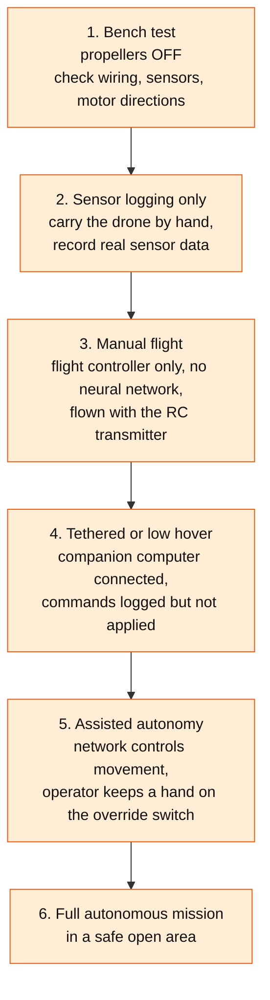

### Step 5.3: Collect the Real Sensor Data

From step 2 of the ladder onward, real data is recorded: camera images, distance readings, IMU, GPS, barometer, and the commands that were sent. The real data is then compared with the simulated data:

- Are the image brightness and colors similar?
- Is the sensor noise similar to what was simulated?
- Is the delay (latency) between sensor and decision small enough?
- Are the coordinates and units the same?

### Step 5.4: Handle the Simulation-to-Reality Gap

The network is trained in simulation, so it will not work perfectly in the real world at first. This is normal. When it happens:

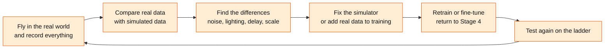

### Step 5.5: Real-Time Data Flow on the Real Drone

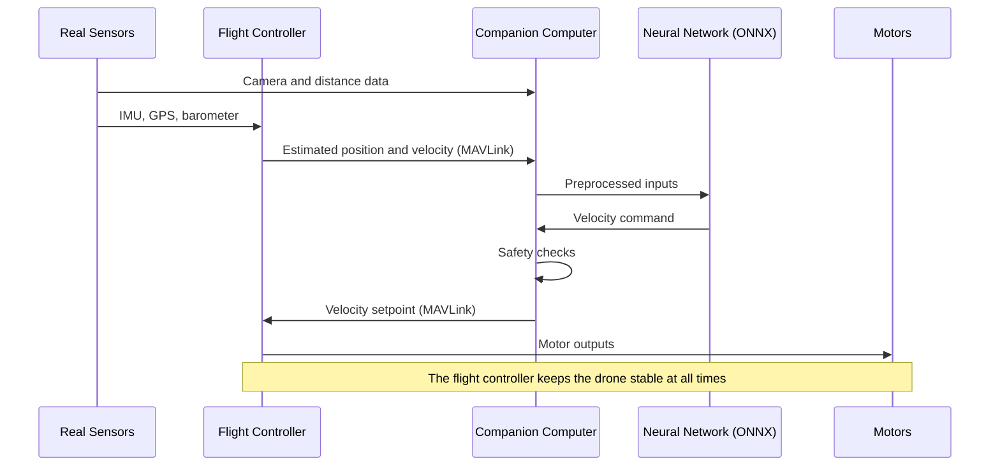

### Deliverables
- [ ] Detailed design (schematics, CAD notes, material selection, structural analysis): `docs/hardware/4-detailed-design/`
- [ ] Wiring diagram, mounting plan and configuration: `docs/hardware/4-integration-design/`
- [ ] Hardware-software interface: `docs/hardware/4-detailed-design/hardware-software-interface.md` and `docs/hardware/4-integration-design/hardware-software-interface.md`
- [ ] Finished parts list: `docs/hardware/6-assembly/bill-of-materials.md` and `component_bill.xlsx`
- [ ] Assembly instructions and build log with photos and notes: `docs/hardware/6-assembly/assembly-instructions.md`
- [ ] Bench, bring-up and flight test plans: `docs/hardware/5-integration-and-verification/`
- [ ] Real sensor logs saved in `data/` (outside `docs/`)
- [ ] A comparison report (simulated data vs real data) and a note on the first autonomous real flight: `docs/hardware/5-integration-and-verification/test-reports/`
- [ ] Failure modes and safety case updated for the real drone: `docs/hardware/cross-cutting/safety-and-compliance/`
- [ ] Threat model for the radio and telemetry links: `docs/software/cross-cutting/security/threat-model.md`
- [ ] Updated ADRs for hardware changes

### Completion Criteria
Stage 5 is complete when the real drone completes the base mission (take off, fly to a target while avoiding obstacles, land) safely and repeatedly using real sensor data.

---

## Stage 6: Give the Drone a Purpose

### Goal
With the drone able to fly by itself, it receives a job. The example purpose is a **watering drone** or a **fertilizing drone** for plants.

### Step 6.1: Choose the First Purpose
Watering comes first, because water is harmless and mistakes are cheap. Once it works, fertilizing follows. It uses the same system with a different liquid and more careful dosing.

### Step 6.2: Design the Payload System

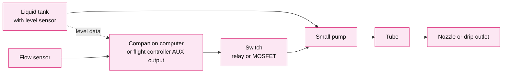

Design considerations:
- **Weight:** 1 liter of water weighs 1 kilogram. The tank adds a lot of weight, so the motors, battery and flight time must handle it.
- **Balance:** the tank must be centered, or the drone will tilt. The weight also changes as the liquid is used, so the flight controller has to cope with that.
- **Prop wash:** the propellers push air down hard. Spraying from high up lets the air blow the liquid away. A low hover height and a nozzle or tube that puts the liquid on the plant, not in the air, are needed.
- **Dosing:** the pump run time and the flow sensor measure how much liquid each plant gets.
- **Electronics protection:** liquid and electronics do not mix. The wiring must be protected and the pump system kept away from the flight controller.

### Step 6.3: Teach the Drone to Find Plants

The drone needs to know **where the plants are**. There are two options:

1. **Easy first version:** give the drone a list of GPS coordinates for the plants.
2. **Better version:** train a small vision model (an object detector) that finds plants in the camera image, so the drone can find them by itself.

The plan starts with option 1 and moves to option 2 when the rest works.

### Step 6.4: Create the Mission Logic

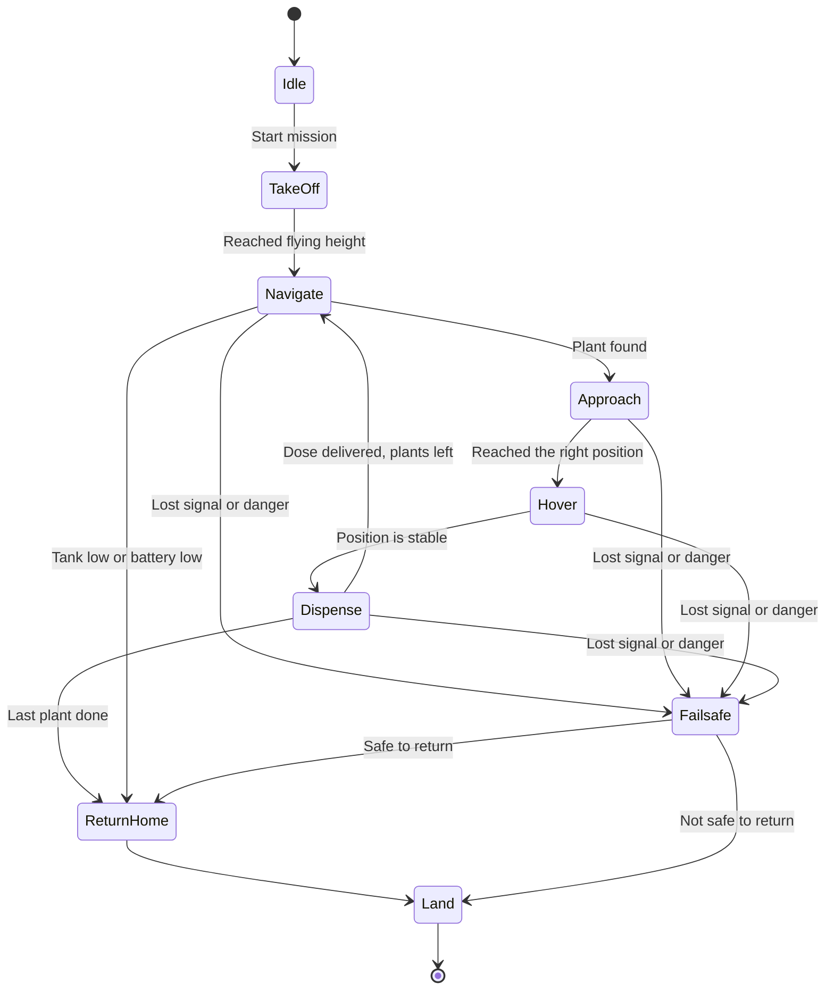

Mission rules:
- The drone **always** checks the battery and the tank level before going to the next plant.
- If either is low, it stops and returns home.
- The pump only turns on when the drone is hovering stably over a plant.
- The pump turns off immediately if anything goes wrong.

### Step 6.5: Test the Purpose Step by Step

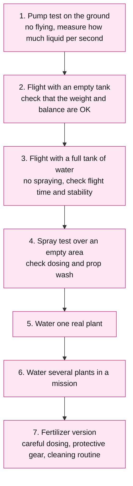

### Step 6.6: Fertilizer Notes (for Later)
- Use the exact amount recommended for the plant, because too much fertilizer can hurt it.
- Wear gloves and eye protection when handling fertilizer.
- Clean the pump, tube and tank after every use, because fertilizer can damage and clog the parts.
- Check the local rules about spraying from a drone before doing it.

### Deliverables
- [ ] Payload design: `docs/hardware/components/sensors-and-payload.md` and `docs/hardware/3-high-level-design/mechanical-layout.md`
- [ ] Updated power budget with the pump and the extra weight: `docs/hardware/3-high-level-design/power-budget.md`
- [ ] Payload wiring diagram: `docs/hardware/4-integration-design/wiring-diagram.md`
- [ ] Pump calibration results (liquid amount per second) and flight time results with an empty and a full tank: `docs/hardware/5-integration-and-verification/test-reports/`
- [ ] Mission logic documented as a diagram: `docs/software/4-detailed-design/lifecycles.md` and `sequence-flows.md`
- [ ] Spill, leak and liquid-on-electronics failure modes: `docs/hardware/cross-cutting/safety-and-compliance/failure-modes-and-effects.md`
- [ ] Spraying rules of the country of operation: `docs/hardware/cross-cutting/safety-and-compliance/regulatory-requirements.md`
- [ ] Video of a real watering mission
- [ ] ADRs for the payload (hardware track) and plant detection (software track) decisions

### Completion Criteria
Stage 6 is complete when the drone completes a real watering mission by itself: it takes off, finds the plants, gives each one the right amount of water, then returns and lands safely.

---

## Safety Rules

These rules are the starting point for the formal safety documents in `docs/hardware/cross-cutting/safety-and-compliance/` (`failure-modes-and-effects.md`, `safety-case.md` and `regulatory-requirements.md`).

1. **Propellers are OFF** during wiring work, motor tests, and whenever the drone is connected to a computer.
2. **A manual override is always available.** The RC transmitter with a kill switch stays in hand at all times.
3. **A geofence is used** so the drone cannot leave the safe area.
4. **Failsafes are set**: return to launch when the signal is lost, and land when the battery is low.
5. **Flights happen only in open, safe areas** away from people, animals and roads, and local laws are followed.
6. **LiPo batteries are handled with care**: use a proper charger, never charge unattended, store them correctly, and stop using any battery that is swollen or damaged.
7. **New software is never tested on the real drone first.** It goes through the simulator first.
8. **A written checklist is used** before every flight and followed every time.

---

## Known Risks

| Risk | Possible impact | Mitigation |
|------|-----------------|------------|
| Simulation is different from the real world | The model works in simulation but fails on the real drone | Domain randomization, compare real and simulated data, fine-tune with real data |
| Model is too slow on the companion computer | Decisions come too late and the drone crashes | Measure speed in Stage 3, optimize, and pick suitable hardware |
| Not enough training data | The model does not generalize | Build more varied worlds and add the failure cases to the data |
| Hardware failure | Crash and damaged parts | Test ladder, spare parts, failsafes |
| Sensor noise or interference | Wrong decisions | Good mounting, filtering, test with real data early |
| Payload changes how the drone flies | Unstable flight in Stage 6 | Design for extra thrust from the start, retune and retest |
| Doing too much at once | Progress stalls and nothing works | One stage at a time, one change at a time, everything documented |

---

## Progress Tracker

This section is updated as the project moves through the stages.

| Stage | Status | Started | Finished | Notes |
|-------|--------|---------|----------|-------|
| 1. Research and data collection | Not started | | | |
| 2. Purpose, design, docs and ADRs | Not started | | | |
| 3. Test and optimize | Not started | | | |
| 4. Train and create the autonomous drone | Not started | | | |
| 5. Real drone with real sensor data | Not started | | | |
| 6. Purpose feature (watering or fertilizing) | Not started | | | |

**Status values:** Not started, In progress, Blocked, Done.

---

*This roadmap is a living document. When something new is learned or a decision changes, this file is updated and an ADR is written to explain why.*